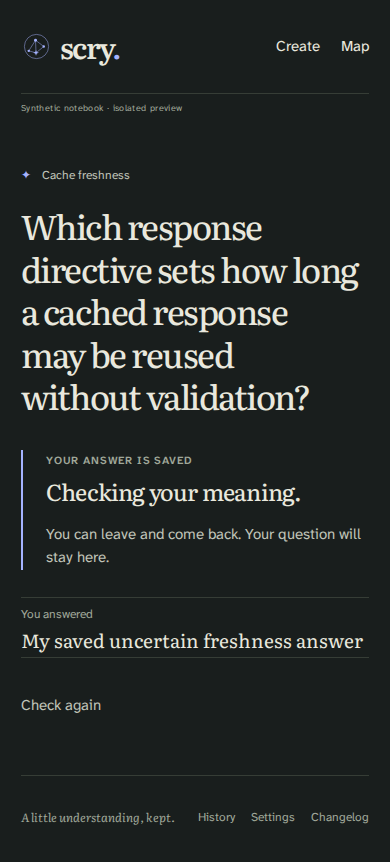
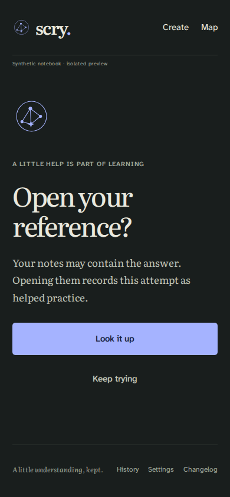

# Saved notebook recovery links, 2026-10-20

This is the current B1-residual builder proof for [PR #345](https://github.com/misty-step/scry/pull/345),
[ticket #319](https://github.com/misty-step/scry/issues/319) under
[#313](https://github.com/misty-step/scry/issues/313), following the
[judge's FIX ruling at 5ea6](https://github.com/misty-step/scry/pull/345#issuecomment-6300714698).
SPEC alone owns intent: US-018/016/017/007, preserved US-002.2, S02.2/.6,
D3, S06 and US-013/S11. The [previous fix receipt](../fix-345/README.md) and
[original phone receipt](../README.md) remain byte-for-byte unchanged.

## Source and change

Implementation/test source is committed
[`b8155fab94740813e7e8530a45887d7701216bb1`](https://github.com/misty-step/scry/commit/b8155fab94740813e7e8530a45887d7701216bb1).
Ordinary merge `668bfea15af0ea093e237e750d070d6fa57ba423` first carried master
`6b8ebeeb58ef9797b594d7ec4a005a2d5b37ba16`: PR #352's QA deadline/log-observation
helper and proof changes, with no application change. No unmerged work was
integrated. The later receipt commit changes only documentation/evidence.

`src/web.rs` now derives `legacy_home(app)` from the unchanged
`exact_stream_active(app)` predicate. Mutation returns and error views use it
through the existing return adapter. So do all three links to a saved legacy
operation: **Check again**, gate **Keep trying**, and checking-reference
**Return to your saved answer**. Once exact practice owns `/`, these return to
`/notebook`; otherwise they still return to `/`. The intentional wordmark,
Go to practice, Return to practice and not-found links retain `/`.

Engine, runtime, Study, model, API, persistence, CLI, JS and CSS are unchanged
from 5ea6. No scheduling, history, assistance, disclosure, CSRF or replay rule
changed. The earlier POST/error repair remains intact.

[Source, artifact, toolchain, gate results and raw-log hashes](source-artifact.json)
bind the committed archive to the frozen 0.3.0 Worker used by both browser runs:

- WASM SHA-256: `a55d8e5050152fda4b0ea96ecd9631dd17b8f2a43d30701b6029812943dc9773`.
- Loader SHA-256: `08a0e0b5782f80a534aad9bdbf2a14eb98ab8cbf6bc34a52fb952194baee8990`.

These identities do not relabel the earlier ad7529d builder or 5ea6 QA artifacts.

## Observed proof

- **Native before: FAIL.** At 5ea6, the new rendered-link census found 20 wrong
  recovery destinations across question/checking/result and exact Prompt or
  caught-up states. All three link labels were observed. See [the red run](native-before.txt).
- **Native after: PASS.** [The identical census](native-after.txt) covers all
  three ownership modes, three legacy phases and six routes: `/notebook`,
  `/gate`, current concept, goal, question edit and not-found. The checking
  state is a real unassisted recall staged through the engine, not a manually
  changed assistance flag. Every recovery link has the expected destination;
  all remaining root links match the intentional-label allowlist. Rendering
  changes no state, and `/` retains its identical exact view.
- **No-Study HTML: PASS 18/18.** Full rendered HTML hashes, including every
  href, are equal before and after for every no-Study phase/route combination.
  [The comparison](no-study-comparison.json) records the shared digest; the
  before/after logs retain every hash.
- **Fresh Worker browser: PASS 2/2.** [VM results](browser-results.json), at
  390px/dark with JS and with JavaScript disabled, use actual touch events.
  From `/gate`, Keep trying returns to the open question at `/notebook`.
  After a typed uncertain answer, Check again returns to `/notebook` with
  the same saved checking answer visible. After each recovery, `/` still
  shows the exact Prompt and SQLite exact practice equals its initial value.
- **Existing no-Study browser walks: PASS 10/10.** The same frozen Worker
  passes native forms, keyboard/held feedback, lost response, offline pause,
  stale tabs, assistance, access loss, layouts, stopped Create and restored
  Settings resume. These are fresh observations, not transferred labels.
- **T3 native pointer/keyboard: PASS.** [The observed journey](t3-observations.json)
  independently follows Check again to the saved answer and Keep trying to
  an open question on fresh mixed fixtures. Root then shows the same exact
  Prompt; SQL snapshots confirm unchanged exact practice. The screenshots
  were inspected for readable saved text, reachable links and retained context.




The existing QA clock holds an unpaused check without sending work: the
fixture's clock is one day ahead of the real runner, so its one-second work
alarm does not fire during the walk. The answer is committed by the actual
shared handler, never by direct SQL fixture editing. Provider bindings are
absent and external egress is denied. This proves navigation of a saved check,
not provider usefulness or a completed meaning judgment.

## Rerun and gates

Use the pinned toolchain and an `env -i` allowlist in a fresh owned directory.
The [browser runner](browser-walk.mjs) expects `source/` from `git archive b8155fa`,
its tested Worker in `source/build/`, and `source-meta.json` beside that source.
Run it from `source/` with Node 22.22.0, Playwright 1.63.0 and matching Chromium
153.0.8010.12/build 1243 in the documented isolated VM. It writes JSON and
screenshots beside the source. `qa/legacy-recovery-links.mjs` owns the new walk;
the existing `qa/browser-recovery.mjs` owns the ten compatibility walks.

```sh
cargo test --locked --test study mixed_notebook -- --nocapture
cargo test --locked --test study --test web_render
cargo fmt --all -- --check
cargo clippy --locked --all-targets -- -D warnings
cargo clippy --locked --target wasm32-unknown-unknown -- -D warnings
cargo check --locked --target wasm32-unknown-unknown
worker-build --release --locked
node ../browser-walk.mjs
```

All 34 affected native tests, format, both Clippy targets, WASM check and
worker-build passed at b8155fa. Normal Gitleaks 8.30.1 passed on its complete
committed source archive with `gitleaks dir SOURCE --redact --no-banner`.
No scanner allowance, suppression or credential configuration changed.

Full raw logs, all screenshots, T3 recording, source/archive/Worker bytes and
initial tool failures remain at
`/home/phaedrus/.cache/tmp/scry-345-links-e71rr8jw`. `SHA256SUMS` covers this
focused receipt. One stale T3 ref and one detached element during polling were
refused actions, not acceptance. They remain recorded; Keep trying was then
followed on a fresh fixture with the observed role locator, and root was opened
through native browser navigation. The final VM run passed on its first run.

## Retained acceptance and limits

[5ea6 delta QA](https://github.com/misty-step/scry/pull/345#issuecomment-6300534148)
continues to cover the preceding POST/error repair. The
[c708 QA](https://github.com/misty-step/scry/pull/345#issuecomment-6299436065)
continues to cover unchanged disclosure, assistance, immutable Correction,
CSRF/Origin, replay, CLI/R2 parity and recovery bytes. Their original source
and artifact identities remain separate. No full gauntlet or new-head CI is
claimed here; fresh independent delta QA/review/judgment and protected CI remain
root-owned and required.

The old broad 34/35 `fetch failed` remains unclassified and is not attributed
to #344 or the carried deadline proof. The historical strict-ignore
ACCESS_AUDIENCE diagnostic retains its FAIL; the normal scanner remains PASS.
Physical phone/canonical wording/owner acceptance (#320), hosted ingress (#335),
fresh or independent hosted recovery (#318) and provider quality/spend (#322)
remain UNVERIFIED. No production action, merge, activation, provider call,
credential change or additional issue closure is claimed.
