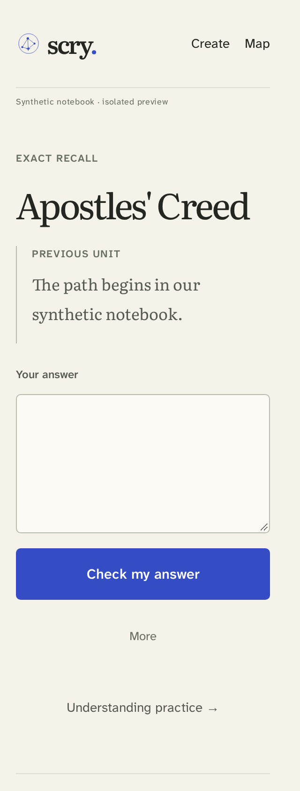
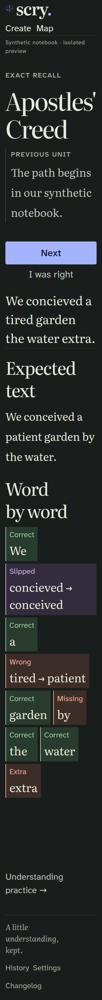
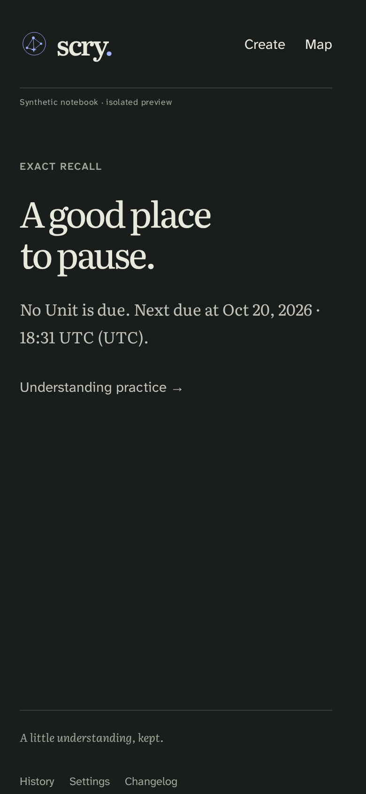
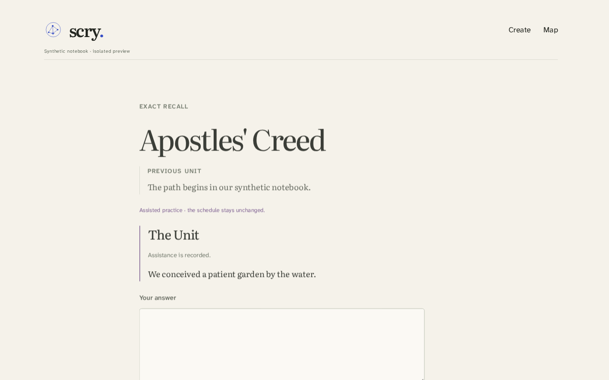

# Phone Stream builder proof

Ticket [#319](https://github.com/misty-step/scry/issues/319), accepted slice plan
[#313](https://github.com/misty-step/scry/issues/313). Behavior authority is
[SPEC US-018](../../../../SPEC.md#us-018-practise-exact-recall-on-my-phone), with
US-007, US-016, US-017, UX4 and AG1.

The implementation starts at fixed review base
`f10e170d2967c9a7c3f5860a020a673c5cd05bb5` and retains that history. Parent
[Study PR #343](https://github.com/misty-step/scry/pull/343) moved to
`3344c8b16bf23f6f1a242c052b4e0840850d231b`, with the identical complete source
tree and fixed base `294f99808a352e066ca6a59cfaa8320eb37d2ee7`, as recorded in
[the parent integration report](https://github.com/misty-step/scry/pull/343#issuecomment-6297944183).
Root owns parent integration and bottom-first landing.

These are synthetic development observations, not a release receipt. The
fixture supplies authored clauses under Apostles' Creed and Roman Missal 2011
metadata. No canonical text, owner notebook, production capability or paid
provider is used. The compiled Worker uses fresh local SQLite and R2.

## Known prerequisite blockers

Parent QA confirmed [historical operation replay can disclose a target without
marking a newer Free recall Prompt assisted](https://github.com/misty-step/scry/pull/343#issuecomment-6297984170).
The shared handlers need that fence. The phone does not implement a separate
fence or alter immutable Attempts. Parent QA also found a
[malformed restore-dry-run panic](https://github.com/misty-step/scry/pull/343#issuecomment-6298022920).
Both belong to the prerequisite builder. Their fixes and affected verification
must be integrated before this branch's final independent QA.

## Reproduce

Use pinned runtimes and an `env -i` allowlist with no operator or provider keys.
Start `node qa/phone-serve.mjs PORT` and open its printed loopback URL with T3
preview. The second Unit opens in Free recall with its previous Unit visible.
Type `We concieved a tired garden the water extra.` for all five Diff marks.
Refresh the held result, correct it, choose Next, and inspect the next due time.
Start a fresh fixture for Show me before answering.

`qa/walk --stories "US-018"` runs the same journey at 320, 390 and 1280 CSS px
in light and dark. The 320 px cases double all computed text sizes. Native
forms also run with JavaScript disabled. A complete local R2 archive restores
the exact frozen Prompt into another isolated runtime. Compiled `scry answer
--json` must return the same Grade and Diff. Exact-route failure checks cover
unknown-response reconciliation, stale tabs, offline pause, automatic Good
Correction and access loss. The runner retains JSON and screenshots in its
owned `target/walk` directory and preserves all other discovery/gate behavior.

Emulation does not establish physical-phone behavior, keyboard occlusion,
private canonical wording quality, deployed private ingress, production
activation or learning efficacy. Those remain UNVERIFIED. No cold filesystem
nonallocation claim is made. Populated rollback needs a compatible forward
writer that retains disclosure Attempts and their effects.

## Retained observations at `32cba95`

The [source/artifact receipt](walk-receipt.json) binds implementation
`32cba9550ab9710ab2bc26b55fd7e0b9a35e7348` to the exact Worker WASM
`43dc1f2e2bbedc8e8a7b41dc1bc7872412b871c6c35b3131ad2692de73afb9a5`.
The isolated VM extracted `git archive` of that commit and used Node 22.22.0,
Rust 1.98.1, pinned dependencies and Chromium on cloud-home-agents.exe.xyz.
Mirrodin refused SSH. T3 preview separately drove native keyboard and pointer
actions against loopback workerd on the workstation. No workstation headless
Chromium was launched.

- PASS: all five US-018 criterion walks in six viewport/theme variants.
  [Phone/CLI Grades and exact frozen Prompts](logs/US-018-phone.json) retain the
  full word marks and local R2 snapshot digest for each comparison.
- PASS: [five exact-route recovery cases](logs/US-018-recovery.json), including
  one frozen operation after response loss, stale tabs, offline pause,
  automatic Good Correction and private DOM removal. These cases do not
  exercise or settle the inherited historical-replay blocker above.
- PASS: unchanged legacy browser recovery, Create and release journeys, as
  recorded in the receipt. [Native tests](logs/rust-tests.txt),
  [native/WASM lint](logs/lint.txt), [WASM build](logs/wasm-build.txt),
  [all 21 Study runtime criteria](logs/study-runtime.txt), and
  [26 discovery/CLI guards](logs/discovery.txt).
- FAIL: [the broader runtime suite](logs/runtime-full.txt) passed 34/35.
  `preview: QA keeps local study and learner self-check without inheriting paid
  Jev` returned `fetch failed`. Its [focused rerun](logs/runtime-focused.txt)
  passed 1/1. The first failure remains retained and unclassified. It is not
  claimed to be backup issue #344, and no gate was weakened or skipped.
- PASS: [T3 keyboard, refresh and pointer transcript](t3-actions.json).
  Screenshots were inspected for wrapping, labels and controls at narrow and
  desktop widths in both themes. The 200% check doubles computed text sizes;
  it does not simulate a physical software keyboard or certify phone hardware.

The screenshots below are synthetic and contain no canonical private wording.
The [complete screen set](screens/) includes no-JavaScript forms and 200% text
sizing. At 200%, the wrapped masthead initially overlapped the synthetic badge;
placing that badge in ordinary flow fixed the overlap before this receipt.

