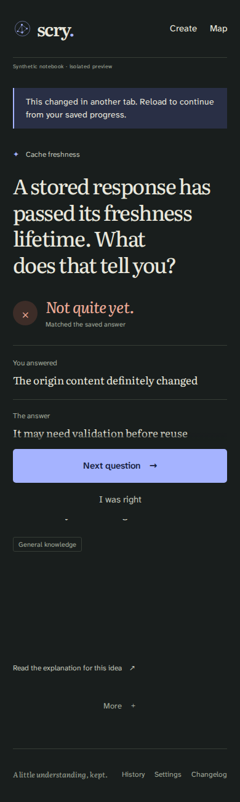
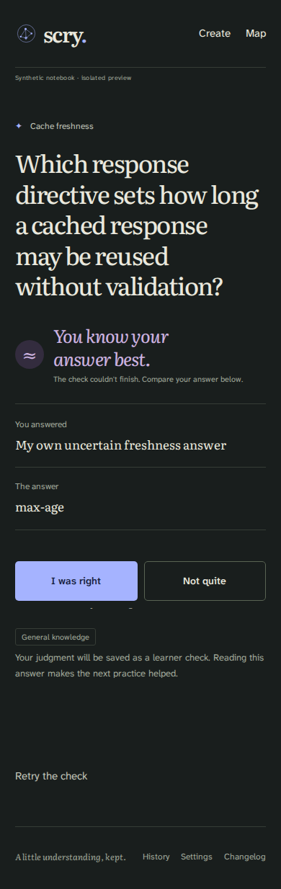

# Mixed notebook return fix, 2026-10-20

[PR #345](https://github.com/misty-step/scry/pull/345),
[ticket #319](https://github.com/misty-step/scry/issues/319) under
[#313](https://github.com/misty-step/scry/issues/313).
This addresses B1 in the [judge's FIX ruling](https://github.com/misty-step/scry/pull/345#issuecomment-6299791317).
SPEC remains the authority: US-018/016/017/007 and the preserved
US-002.2, S02.2/.6, D3, S06 and US-013/S11 understanding loop.

## Change and provenance

The exact Stream still owns `/` when a current exact Prompt or a non-dropped
Study exists. Browser returns from `/review/intro`, `answer`, `reveal`, `self`,
`retry`, `override`, `next`, `/settings/resume`, and `/concepts/{id}/practice`
then use `/notebook`. Their errors render that same understanding view.
`/review/help` keeps its reference destination; its errors retain the notebook.
No-Study returns still use `/`. Exact `/practice/*` returns still use `/`.
Create and edit errors keep their existing pages.

`src/web.rs` shares the existing Stream-ownership predicate between rendering
and those browser returns. `src/runtime.rs` calls the two presentation helpers.
Engine/API/CLI results and persisted operation receipts remain unchanged,
including old receipts whose saved redirect is `/`. An identical browser replay
gets the correct notebook return without another learning event or receipt.
The existing browser save still increments the storage revision on replay.

Started at `c7084812ebc8a0c11bd9a1690032ba01a2deae8e` on the owned
`feat/exact-phone-stream` branch. Ordinary merge `d8eeb8f` carries master
`99415ae` and its backup fixture plus three receipts. Ordinary merge `1b507b1`
then carries release `69435af34fe7a8be7b5683f8b5d3e6b27852e177`, exactly six
generated 0.3.0 metadata/changelog files beyond 99415ae. No reset, rebase,
force-push, store change or activation occurred.

The final committed implementation/test source is
[`ad7529ddec6adacc5a0d68cb48e134004f453e83`](https://github.com/misty-step/scry/commit/ad7529ddec6adacc5a0d68cb48e134004f453e83).
[Source, artifact, toolchain and raw-log hashes](source-artifact.json) bind its
archive and 0.3.0 Worker. The receipt commit adds documentation and evidence only.
WASM SHA-256 is `a0839b68895bcf30a5b871c5efa417bb5d540249a87a384cd9933b8ff876852c`;
loader SHA-256 is `08a0e0b5782f80a534aad9bdbf2a14eb98ab8cbf6bc34a52fb952194baee8990`.

## Before and after

- **Native before: FAIL 0/3.** On c708 plus the tests and a behavior-preserving
  extraction of its existing browser return rules, all three mixed-notebook
  regressions returned `/` instead of `/notebook`. See [raw red run](native-before.txt).
  A second run with the final assertion wording failed the same three returns.
  The extraction only made the existing WASM-only redirect/error rules callable
  by native tests; it did not supply the fix.
- **Actual c708 Worker before: FAIL.** The same HTTP fixture, using the retained
  c708 WASM `2e3a278899a9fb7b5e984ab2cc00f5a75d5917cf4710f548adcfc2d6e13605bc`,
  returned 409 with an exact Prompt instead of the concept question.
  [Raw refusal](worker-before.txt) uses a fixed diagnostic without private fields.
- **Native after: PASS 3/3** at ad7529d with the same assertions. The
  [regressions](native-after.txt) drive real engine intro, answer, immutable
  override, Next, failed meaning check, retry, learner self-check, reveal,
  concept practice and resume. Each runs with and without a Study. They check
  held feedback, 409/422 views, exact-state equality and operation replay.
- **Browser after: PASS 2/2 mixed, PASS 10/10 no-Study.** The
  [actual VM results](browser-results.json) bind ad7529d and the exact WASM above.
  At 390px, light with JS and dark with JavaScript disabled, native taps answer,
  refresh held feedback, submit a stale-tab 409, override, choose Next, answer
  in words, self-check and choose Next again. `/notebook` retains each stage;
  `/` still shows the identical exact Prompt. SQLite exact practice is equal
  before and after. The ten existing recovery walks include native forms,
  keyboard, lost response, offline, stale tabs, help, access loss, layouts,
  stopped Create preparation and restored Settings resume.
- **Worker after: PASS 31/31.** The mixed HTTP regression observes 409 and 422
  concept-question pages with all rows unchanged, a held answer at `/notebook`,
  and a replay with unchanged learning rows/receipts. See the frozen-artifact
  runtime result in `source-artifact.json` and the retained raw log.

The T3 collaborative preview separately used actual keyboard/pointer actions
at 390px on loopback: wrong choice, held refresh, override, typed meaning check,
learner check, deliberate Next, unchanged exact Prompt. A second real tab's
stale choice received 409 while retaining the concept view and editable context.
Its full journey used the 9fb49a3 Worker `b117cdeb…`; ad7529d changes only one
browser-test navigation wait and the compiled source identity. The final VM
journeys above use ad7529d bytes. T3 recordings, snapshots and SQL observations
retain their actual source identities in the scratch evidence.




The images were inspected for visible question, answer, error and learner
controls. They establish synthetic mechanics, not physical-phone acceptance.

## Rerun and gates

Use Rust 1.98.1, worker-build 0.8.7, Node 22.22.0 and lockfile dependencies in an
`env -i` allowlist. Use fresh owned SQLite/local R2 and no provider capability.

```sh
cargo test --locked --test study mixed_notebook -- --nocapture
cargo fmt --all -- --check
cargo clippy --locked --all-targets -- -D warnings
cargo clippy --locked --target wasm32-unknown-unknown -- -D warnings
cargo check --locked --target wasm32-unknown-unknown
worker-build --release --locked
node --test qa/study.test.mjs qa/study-integrity.test.mjs
```

The full native run passed 145 tests with one existing Unicode fixture ignore;
format, both Clippy targets and WASM check passed on 9fb49a3. Its Rust/Cargo,
assets and runtime-helper bytes are identical at ad7529d. The ad7529d build,
format and focused native tests passed again. The final runtime run freezes the
ad7529d Worker in a separate `SCRY_WORKER_ARTIFACT` directory, so another build
cannot alter its bytes between fixtures.

[The browser runner](browser-walk.mjs) runs both mixed variants and all ten
existing recovery walks on the documented isolated VM. Put it in a new run
folder beside `source/` extracted from `git archive ad7529d`, copy the tested
Worker into `source/build/`, write `source-meta.json` with that source identity,
and run `node ../browser-walk.mjs` from `source/` with pinned Playwright 1.63.0
and its matching Chromium installed. It retains `browser-results.json` and
`screens/` beside the source. The implementation fixture is
`qa/mixed-notebook.mjs`; the HTTP regression is part of the existing protected
`qa/study-integrity.test.mjs` gate.

Normal Gitleaks 8.30.1 command `gitleaks dir COMMITTED_ARCHIVE --redact --no-banner`
passed. No allowance, suppression, credential or scanner configuration changed.

Raw evidence remains at
`/home/phaedrus/.cache/tmp/scry-345-fix-6k7c6m8z`, including frozen artifacts,
committed source archives, commands, full native/runtime/build/scanner output,
all VM screenshots and initial failures, T3 SQL snapshots and recordings.
Hashes in `source-artifact.json` cover the raw logs; `SHA256SUMS` covers this
focused committed evidence. These are development receipts, not release proof.

## Retained failures and limits

The [first no-JS walk](browser-initial-failure.json) reached held result, 409,
override and learner self-check, then its immediate `page.goto("/")` aborted
an unfinished native Next navigation. The test now waits for the result to
leave before navigating. No application workaround was added. An initial native
assertion used the wrong correction label; the diagnostic was corrected before
the final red/green pair. Initial assertion dumps were redacted, and assertions
now avoid printing forms or row payloads.

The original 7cfbbb7/32cba95 receipt remains byte-for-byte unchanged. The
[c708 independent QA](https://github.com/misty-step/scry/pull/345#issuecomment-6299436065)
continues to cover unchanged disclosure, assistance, corrections, replay,
CSRF/Origin and recovery bytes. The earlier broad 34/35 `fetch failed` remains
unclassified; a focused pass never erased or attributed it. The strict
ignore-allow scan remains a historical FAIL on unchanged public ACCESS_AUDIENCE.
The normal source scanner remains PASS.

Physical phone, real canonical wording and owner acceptance (#320), deployed
ingress (#335), fresh/independent hosted recovery (#318) and provider quality
or spend (#322) remain UNVERIFIED. Counts #346, capacity #347, docs/scratch #349
and telemetry #350 remain separate. No other issue closure, historical-store
operation, provider call, production action, merge or deployment is claimed.
Fresh independent delta QA/review/judgment and exact-head protected CI are
root-owned and still required.
